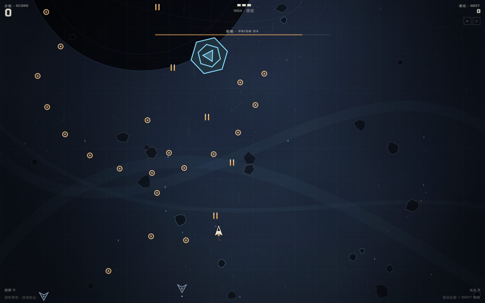

# 弹雨 · Bullet Rain

OpenChamber 侧栏里的竖屏弹幕射击：移动、自动射击、躲弹幕。七种敌机、四个区域、无限波次。

<p align="center">
  
</p>

## 安装

在 OpenChamber 的 **Settings → Extensions** 里添加：

```text
https://github.com/Insulindian/openchamber-bullet-rain
```

构建产物 `panel/main.js` 已提交，安装不需要构建工具。已安装的话用扩展更新器更新。

## 操作

- 指针移动，自动开火
- 按住左键 / Shift 精确移动
- 右键 / P / Esc 暂停，R 重开

## 内容

- 7 种敌机，大小、颜色、机身下方方块数同时表示强度
- 每 2 波一次强化：射速 / 伤害 / 多重射击
- 每 4 波一个首领，三形态、三阶段，半血与残血各提速一次
- 每 4 波切换区域：深空 / 余烬 / 冰原 / 赤潮
- 5 种临时道具：超载 / 迟滞 / 护盾 / 脉冲 / 修复
- 3 点 HP，过关、击破首领、拾取修复都能回复
- WebAudio 合成音效（射击、擦弹、爆炸、首领警报等），右上角可静音
- 无限波次；最高分写在扩展存储里

## 开发

```sh
npm install
npm run build
```

调试参数：`?auto=1`、`?god=1`、`?wave=N`、`?speed=N`、`?steps=N`、`?drop=all`、`?hp=N`、`?dbg=1`。

画面全部由 Canvas 程序化绘制。字体 ZCOOL QingKe HuangYou + Chakra Petch（SIL OFL，`panel/fonts/` 内附授权）。
